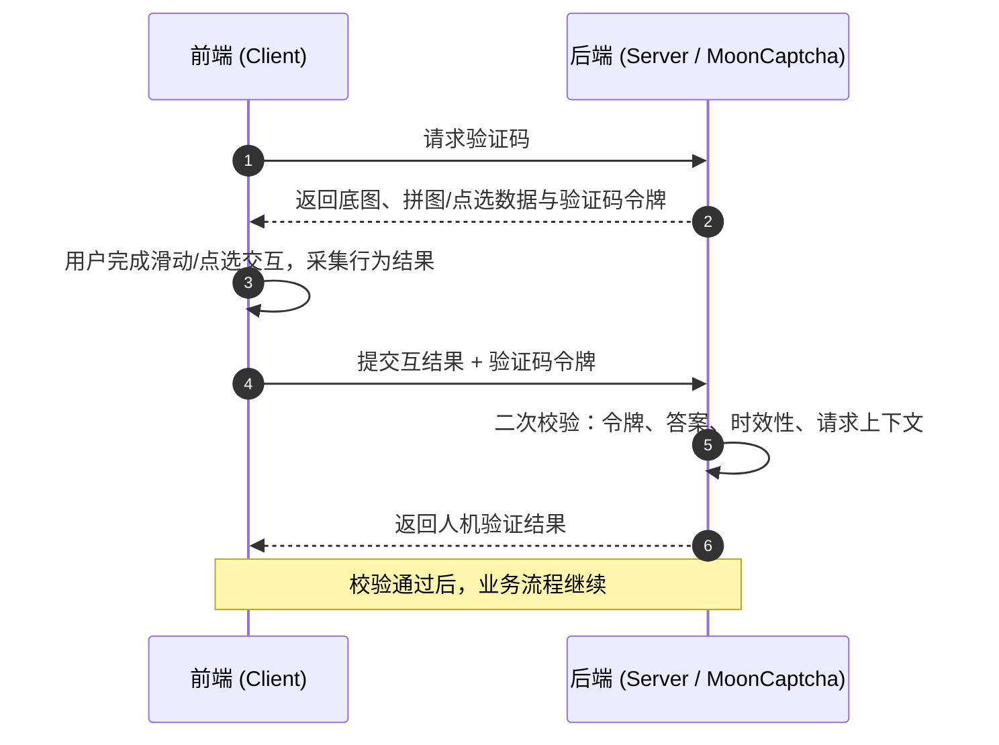

<div align="center">

# MoonCaptcha

**基于 MoonBit 的行为验证码组件**

**A Behavioral CAPTCHA Component Based on MoonBit**


**简体中文 · [English](./README.en.md)**

</div>

---

### 项目简介

MoonCaptcha 是一个基于 [MoonBit](https://www.moonbitlang.com/) 的行为验证码组件，计划将 [AJ-Captcha](https://gitee.com/belief-team/captcha) 的行为验证码能力移植到 MoonBit 生态，为 Web 应用、移动端应用、管理后台、开放平台及各类业务接口提供可复用的交互式人机验证方案。

传统图形验证码要求用户辨认并输入扭曲的字符，操作成本高、体验差。MoonCaptcha 采用行为验证码：用户只需完成拼图滑动，或按指定顺序点击文字，即可完成验证，无需手动输入字符。前端负责采集用户行为及交互结果，后端对验证码令牌、答案、时效性和请求上下文进行二次校验，最终返回人机验证结果。

除行为验证码外，MoonCaptcha 继续保留图形验证码能力，用于不支持脚本执行、无障碍访问、嵌入式环境受限或业务仍依赖传统字符验证的场景。项目还将提供弹出式和嵌入式两种 UI 接入方式，使同一套验证逻辑能够适配登录弹窗、表单页面、独立验证页及移动端界面。

### 核心特性

**🧩 多种验证方式**

- **滑动拼图**：拖动滑块，将拼图块对准底图缺口即可完成验证；
- **文字点选**：按提示顺序依次点击图片中的文字，即可完成验证；
- **图形验证码**（保留）：面向不支持脚本执行、无障碍访问、嵌入式环境受限或仍依赖传统字符验证的场景。

**🪟 两种 UI 接入方式**

- **弹出式**：点击触发，以浮层形式呈现，适合登录弹窗等场景；
- **嵌入式**：直接嵌入表单页面，适合注册、评论等表单场景；
- 同一套验证逻辑，可适配登录弹窗、表单页面、独立验证页及移动端界面。

**🔐 安全的二次校验机制**

- 验证码由服务端生成，前端交互结果仅作为校验输入；
- 验证码令牌一次性使用，防重放攻击；
- 校验答案匹配、有效期与请求上下文，不信任前端提交的结果。

**🚀 MoonBit 生态优势**

- 核心验证逻辑使用 MoonBit 实现，可编译到 WASM / JS / Native 等多种目标；
- 同一套核心代码可在浏览器、服务端与边缘环境中复用，降低多端接入成本。

### 工作原理



1. 业务前端向业务后端请求验证码；
2. MoonCaptcha 生成底图与拼图 / 点选数据，并返回一次性验证码令牌；
3. 用户完成滑动或点选交互，前端采集交互结果（如滑动距离、点击坐标）；
4. 前端将交互结果与验证码令牌一并提交至后端；
5. 后端进行二次校验：令牌有效性、答案匹配、时效性与请求上下文；
6. 校验通过后返回验证结果，业务流程继续。

### 项目状态与路线图

> 🚧 MoonCaptcha 目前处于规划设计阶段，接口与模块划分尚未定型，欢迎通过 Issue 参与讨论。

| 能力 | 状态 |
| --- | --- |
| 滑动拼图验证（生成 → 校验 → 二次校验全链路） | ✅ 已实现（图像栈完整） |
| 文字点选验证（布点 + 文字烧录 + 逐点校验） | ✅ 已实现（TTF 字体光栅化） |
| 图形验证码 | 🚧 规划中 |
| 弹出式 / 嵌入式 UI | 🚧 规划中 |
| 后端二次校验 API | ✅ 已实现（门面 CaptchaService + 频控 + CSPRNG） |
| HTTP 服务示例 | ✅ [examples/js-server](examples/js-server/README.md)（MoonBit 引擎 + Node 宿主，协议 E2E 10/10） |
| 文档与示例 | 🔄 开发中（[源码分析](docs/aj-captcha-analysis.md) / [迁移设计](docs/migration-design.md) 已发布） |

当前进度详见 [docs/migration-design.md](docs/migration-design.md) §5 里程碑。

### 快速开始

项目尚在开发中，暂未提供稳定版本。安装方式、API 文档与接入示例将随首个可用版本一同发布，敬请期待。

可以先通过 `demo/` 目录下的 Web 登录演示页体验两种行为验证码的完整流程（见 [demo/README.md](demo/README.md)）：

```bash
node demo/server.js
# → http://localhost:3000
```

### 相关项目

- [AJ-Captcha](https://gitee.com/belief-team/captcha) — 本项目的移植来源，行为验证码（滑动拼图、点选文字）
- [MoonBit](https://www.moonbitlang.com/) / [MoonBit 文档](https://docs.moonbitlang.com/) — MoonCaptcha 所使用的开发语言

### 参与贡献

欢迎提交 Issue 与 Pull Request！

1. Fork 本仓库并创建你的分支；
2. 提交更改；
3. 发起 Pull Request。

### 开源协议与致谢

- 本项目基于 [MIT License](./LICENSE) 开源；
- 感谢 [AJ-Captcha (anji-plus/captcha)](https://gitee.com/belief-team/captcha)（Apache-2.0）提供的设计灵感与移植基础。
