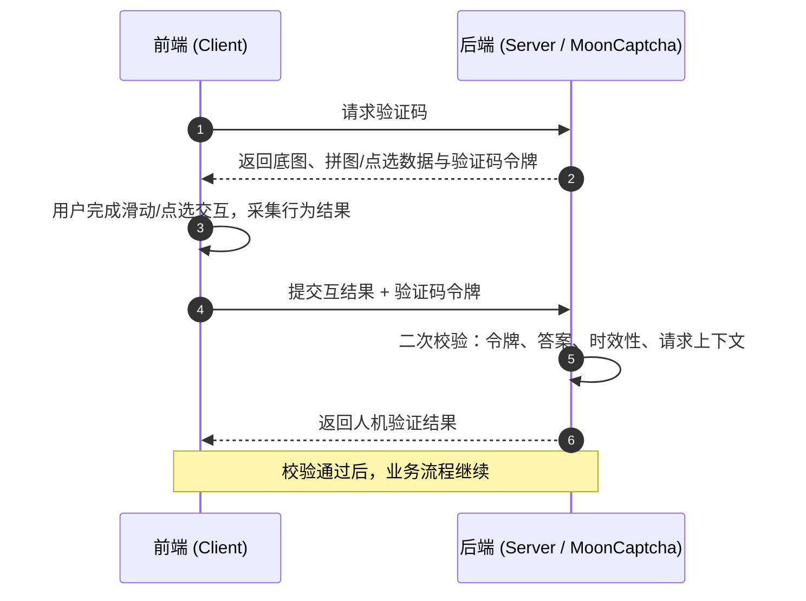

<div align="center">

# MoonCaptcha

**基于 MoonBit 的行为验证码组件**

**A Behavioral CAPTCHA Component Based on MoonBit**


**[简体中文](#简体中文) · [English](#english)**

</div>

---

## 简体中文

### 项目简介

MoonCaptcha 是一个基于 [MoonBit](https://www.moonbitlang.com/) 的行为验证码组件，计划将 [AJ-Captcha](https://gitee.com/belief-team/captcha) 的行为验证码能力移植到 MoonBit 生态，为 Web 应用、移动端应用、管理后台、开放平台及各类业务接口提供可复用的交互式人机验证方案。

传统图形验证码要求用户辨认并输入扭曲的字符，操作成本高、体验差。MoonCaptcha 采用行为验证码：用户只需完成拼图滑动，或按指定顺序点击文字，即可完成验证，无需手动输入字符。前端负责采集用户行为及交互结果，后端对验证码令牌、答案、时效性和请求上下文进行二次校验，最终返回人机验证结果。

除行为验证码外，MoonCaptcha 继续保留图形验证码能力，用于不支持脚本执行、无障碍访问、嵌入式环境受限或业务仍依赖传统字符验证的场景。项目还将提供弹出式和嵌入式两种 UI 接入方式，使同一套验证逻辑能够适配登录弹窗、表单页面、独立验证页及移动端界面。

### 核心特性

**🧩 多种验证方式**

- **滑动拼图**：拖动滑块，将拼图块对准底图缺口即可完成验证；
- **文字点选**：按提示顺序依次点击图片中的文字，即可完成验证；
- **图形验证码**（保留）：面向不支持脚本执行、无障碍访问、嵌入式环境受限或仍依赖传统字符验证的场景。

**🪟 两种 UI 接入方式**

- **弹出式**：点击触发，以浮层形式呈现，适合登录弹窗等场景；
- **嵌入式**：直接嵌入表单页面，适合注册、评论等表单场景；
- 同一套验证逻辑，可适配登录弹窗、表单页面、独立验证页及移动端界面。

**🔐 安全的二次校验机制**

- 验证码由服务端生成，前端交互结果仅作为校验输入；
- 验证码令牌一次性使用，防重放攻击；
- 校验答案匹配、有效期与请求上下文，不信任前端提交的结果。

**🚀 MoonBit 生态优势**

- 核心验证逻辑使用 MoonBit 实现，可编译到 WASM / JS / Native 等多种目标；
- 同一套核心代码可在浏览器、服务端与边缘环境中复用，降低多端接入成本。

### 工作原理



1. 业务前端向业务后端请求验证码；
2. MoonCaptcha 生成底图与拼图 / 点选数据，并返回一次性验证码令牌；
3. 用户完成滑动或点选交互，前端采集交互结果（如滑动距离、点击坐标）；
4. 前端将交互结果与验证码令牌一并提交至后端；
5. 后端进行二次校验：令牌有效性、答案匹配、时效性与请求上下文；
6. 校验通过后返回验证结果，业务流程继续。

### 项目状态与路线图

> 🚧 MoonCaptcha 目前处于规划设计阶段，接口与模块划分尚未定型，欢迎通过 Issue 参与讨论。

| 能力 | 状态 |
| --- | --- |
| 滑动拼图验证（校验流程 + 生成参数逻辑） | 🔄 开发中（核心逻辑已实现并测试） |
| 文字点选验证（布点 + 逐点校验） | 🔄 开发中（核心逻辑已实现并测试） |
| 图形验证码 | 🚧 规划中 |
| 弹出式 / 嵌入式 UI | 🚧 规划中 |
| 后端二次校验 API | ✅ 核心已实现（get/check/verification 流程与协议兼容层） |
| 文档与示例 | 🔄 开发中（[源码分析](docs/aj-captcha-analysis.md) / [迁移设计](docs/migration-design.md) 已发布） |

当前进度详见 [docs/migration-design.md](docs/migration-design.md) §5 里程碑。

### 快速开始

项目尚在开发中，暂未提供稳定版本。安装方式、API 文档与接入示例将随首个可用版本一同发布，敬请期待。

### 相关项目

- [AJ-Captcha](https://gitee.com/belief-team/captcha) — 本项目的移植来源，行为验证码（滑动拼图、点选文字）
- [MoonBit](https://www.moonbitlang.com/) / [MoonBit 文档](https://docs.moonbitlang.com/) — MoonCaptcha 所使用的开发语言

### 参与贡献

欢迎提交 Issue 与 Pull Request！

1. Fork 本仓库并创建你的分支；
2. 提交更改；
3. 发起 Pull Request。

### 开源协议与致谢

- 本项目基于 [MIT License](./LICENSE) 开源；
- 感谢 [AJ-Captcha (anji-plus/captcha)](https://gitee.com/belief-team/captcha)（Apache-2.0）提供的设计灵感与移植基础。

---

## English

### Introduction

MoonCaptcha is a behavioral CAPTCHA component based on [MoonBit](https://www.moonbitlang.com/). It aims to port the behavioral CAPTCHA capabilities of [AJ-Captcha](https://gitee.com/belief-team/captcha) to the MoonBit ecosystem, providing a reusable interactive human-verification solution for web applications, mobile apps, admin consoles, open platforms, and all kinds of business APIs.

Traditional image CAPTCHAs force users to recognize and type in distorted characters, which is costly and frustrating. MoonCaptcha uses behavioral verification instead: users complete verification simply by sliding a puzzle piece into place, or by clicking characters on an image in the prompted order — no typing required. The frontend collects user behavior and interaction results, while the backend performs secondary validation of the CAPTCHA token, the answer, its validity period, and the request context before returning the final verification result.

In addition to behavioral CAPTCHAs, MoonCaptcha retains the classic image CAPTCHA for scenarios where script execution is unavailable, accessibility is required, embedded environments are restricted, or the business still relies on traditional character-based verification. The project will also offer both popup and embedded UI integration modes, so the same verification logic can fit login dialogs, form pages, standalone verification pages, and mobile interfaces.

### Key Features

**🧩 Multiple Verification Modes**

- **Slide Puzzle**: drag the slider until the puzzle piece aligns with the gap in the background image;
- **Text Click**: click the characters on the image in the prompted order;
- **Image CAPTCHA** (retained): for scenarios without script execution, with accessibility needs, in restricted embedded environments, or where the business still depends on traditional character verification.

**🪟 Two UI Integration Modes**

- **Popup**: triggered by a click and presented as a floating layer, ideal for login dialogs;
- **Embedded**: rendered directly inside a form page, ideal for sign-up and comment forms;
- One set of verification logic that adapts to login dialogs, form pages, standalone verification pages, and mobile interfaces.

**🔐 Secure Secondary Validation**

- CAPTCHAs are generated on the server side; frontend interaction results serve only as validation input;
- CAPTCHA tokens are single-use, guarding against replay attacks;
- Answers, validity periods, and request contexts are all validated — frontend results are never trusted blindly.

**🚀 Advantages of the MoonBit Ecosystem**

- Core verification logic is implemented in MoonBit and compiles to multiple targets including WASM / JS / Native;
- The same core code can be reused across browsers, servers, and edge environments, reducing multi-platform integration costs.

### How It Works

```mermaid
sequenceDiagram
    autonumber
    participant C as Frontend (Client)
    participant S as Backend (Server / MoonCaptcha)

    C->>S: Request a CAPTCHA
    S-->>C: Return background image, puzzle/click data, and CAPTCHA token
    C->>C: User completes the slide/click interaction; behavior is collected
    C->>S: Submit interaction result + CAPTCHA token
    S->>S: Secondary validation: token, answer, validity period, request context
    S-->>C: Return the verification result
    Note over C,S: On success, the business flow continues
```

1. The business frontend requests a CAPTCHA from the business backend;
2. MoonCaptcha generates the background image and puzzle / click data, and returns a single-use CAPTCHA token;
3. The user completes the slide or click interaction while the frontend collects the result (e.g. sliding distance, click coordinates);
4. The frontend submits the interaction result together with the CAPTCHA token to the backend;
5. The backend performs secondary validation: token validity, answer matching, validity period, and request context;
6. Once validated, the verification result is returned and the business flow continues.

### Status & Roadmap

> 🚧 MoonCaptcha is currently in the design and planning stage. APIs and module boundaries are not yet finalized — discussions via Issues are welcome.

| Capability | Status |
| --- | --- |
| Slide puzzle verification (validation flow + generation logic) | 🔄 In progress (core logic implemented & tested) |
| Text click verification (point layout + per-point validation) | 🔄 In progress (core logic implemented & tested) |
| Image CAPTCHA | 🚧 Planned |
| Popup / embedded UI | 🚧 Planned |
| Backend secondary-validation API | ✅ Core implemented (get/check/verification flow with protocol-compatible layer) |
| Documentation & examples | 🔄 In progress ([source analysis](docs/aj-captcha-analysis.md) / [migration design](docs/migration-design.md) published) |

See [docs/migration-design.md](docs/migration-design.md) §5 for milestone details.

### Quick Start

The project is still under development and no stable release is available yet. Installation instructions, API documentation, and integration examples will ship with the first usable release — stay tuned.

### Related Projects

- [AJ-Captcha](https://gitee.com/belief-team/captcha) — the upstream project this work ports from; behavioral CAPTCHA (slide puzzle, text click)
- [MoonBit](https://www.moonbitlang.com/) / [MoonBit Docs](https://docs.moonbitlang.com/) — the language MoonCaptcha is built with

### Contributing

Issues and pull requests are welcome!

1. Fork this repository and create your branch;
2. Commit your changes;
3. Open a pull request.

### License & Acknowledgements

- This project is licensed under the [MIT License](./LICENSE);
- Thanks to [AJ-Captcha (anji-plus/captcha)](https://gitee.com/belief-team/captcha) (Apache-2.0) for the design inspiration and the foundation for this port.
